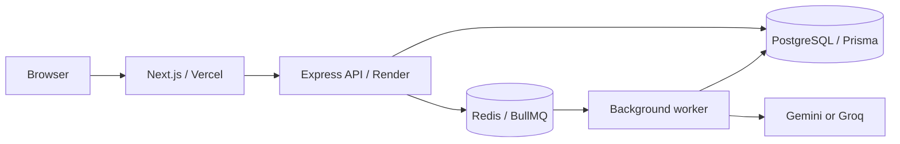

# SupportPilot

AI-assisted customer support and ticket operations platform built with Next.js, Express, PostgreSQL, Prisma, Redis/BullMQ, and Gemini/Groq.

**Live demo:** https://supportpilot-silk.vercel.app  
**API:** https://supportpilot-4br7.onrender.com  
**Health:** https://supportpilot-4br7.onrender.com/api/v1/health

SupportPilot gives customers a simple support portal while giving support teams a production-style workspace for triage, ownership, SLA tracking, conversations, audit history, and human-reviewed AI assistance.

## What it does

### Customer portal
- Register and sign in
- Create support requests
- Track ticket status, priority, category, and response targets
- Continue the public conversation with support
- View resolved requests and support replies
- Never see internal notes or staff-only activity

### Agent and admin workspace
- Search and paginate the ticket queue
- Assign and reassign tickets
- Update status, priority, and category
- Send public replies and add private internal notes
- Review assignment and audit history
- Track first-response and resolution SLA targets
- View database-backed operational metrics
- Admin staff/workload directory

### AI assistance
- Ticket classification
- Conversation summary
- Priority suggestion
- Draft response
- Gemini and Groq provider support
- BullMQ background processing
- Strict structured-output validation
- Human review before applying any suggestion or sending any draft

AI is intentionally a **support copilot**, not an autonomous customer-facing bot.

## Production status

The current deployment has been exercised end-to-end with real application data paths:

- customer registration and login
- ticket creation and persisted ticket detail
- admin login and staff workspace
- assignment/status workflow
- public reply and internal note separation
- SLA state updates
- ticket resolution
- Gemini-backed classification, summary, priority suggestion, and draft reply
- API + BullMQ worker running together on the current Render Web Service

This verifies the deployed product flow; it is **not** a claim of production scale, uptime, or security certification.

## Architecture



| Location | Responsibility |
| --- | --- |
| `apps/web` | Next.js/React frontend and shared workspace components |
| `apps/api` | Express API, auth/RBAC, ticket services, Prisma, AI providers, BullMQ workers |
| `packages/types` | Shared frontend/domain contracts |
| `docs` | Architecture, API, deployment, testing, AI provider, and verification notes |

**Stack:** Node.js 22+, TypeScript, Next.js 15, React 19, Express 5, Prisma 6, PostgreSQL, Redis, BullMQ, Zod, Docker, GitHub Actions.

## Core workflow

```text
Customer
  -> creates ticket
  -> PostgreSQL persists request
  -> support team receives it
  -> agent/admin assigns and responds
  -> SLA state is tracked
  -> AI can classify/summarize/suggest/draft
  -> human reviews and applies changes
  -> ticket is resolved
```

## AI workflow

```text
Staff action
  -> API creates PENDING AIAnalysis
  -> BullMQ queues job in Redis
  -> worker selects configured provider
  -> Gemini or Groq returns structured output
  -> Zod validates result
  -> PostgreSQL stores result
  -> UI renders advisory action
  -> human explicitly applies or sends
```

Internal notes are excluded from provider prompts. Raw provider errors and credentials are not returned to the browser.

## Run locally

Requirements: Node.js 22+, npm, PostgreSQL, and Redis. Docker Desktop is the simplest way to run the local services.

From the repository root:

```powershell
npm ci
if (!(Test-Path .env)) { Copy-Item .env.example .env }
node -p "require('node:crypto').randomBytes(48).toString('hex')"
```

Put the generated value in `JWT_ACCESS_SECRET` inside the private `.env`.

Start local services and prepare the database:

```powershell
docker compose up -d postgres redis
npm run db:generate
npm run db:deploy
npm run db:seed
```

Run the application in separate terminals:

```powershell
npm run dev:api
npm run dev:worker
npm run dev:web
```

Local endpoints:

- Web: http://localhost:3000
- API base: http://localhost:4000/api/v1
- Health: http://localhost:4000/api/v1/health

## Local development accounts

Available only after `npm run db:seed` succeeds. These are synthetic local accounts and are not intended for production use.

Password for newly seeded accounts: `SupportPilot123!`

| Role | Email |
| --- | --- |
| Admin | `admin@supportpilot.local` |
| Support agent | `agent1@supportpilot.local` |
| Support agent | `agent2@supportpilot.local` |
| Customer | `customer1@supportpilot.local` |
| Customer | `customer2@supportpilot.local` |

## Environment configuration

Local defaults are documented in `.env.example`. Production secrets belong in Render/Vercel environment settings, never in Git.

Frontend:

```dotenv
NEXT_PUBLIC_API_URL=https://supportpilot-4br7.onrender.com/api/v1
```

Render API/worker:

```dotenv
NODE_ENV=production
WEB_ORIGIN=https://supportpilot-silk.vercel.app
DATABASE_URL=<private PostgreSQL URL>
REDIS_URL=<private Redis URL>
JWT_ACCESS_SECRET=<private random secret>
AI_PROVIDER=gemini
GEMINI_API_KEY=<private key>
GEMINI_MODEL=gemini-3.5-flash-lite
```

Groq remains available by switching `AI_PROVIDER=groq` and configuring the Groq key/model. There is no silent provider fallback.

## Render deployment

Build command:

```sh
npm ci --include=dev && npm run db:generate --workspace=@supportpilot/api && npm run db:deploy --workspace=@supportpilot/api && npm run build --workspace=@supportpilot/api
```

Current single-service start command:

```sh
npm run start:combined --workspace=@supportpilot/api
```

The combined launcher supervises both the Express API and BullMQ worker in the same Render service. Separate process commands remain available for local development, Docker, or a future dedicated worker service.

## Verification commands

```powershell
npm run db:generate
npx prisma validate --schema=apps/api/prisma/schema.prisma
npm run typecheck
npm test
npm run build
npm run test:e2e
```

CI provisions disposable PostgreSQL and Redis services, applies migrations, typechecks, tests, and builds.

## Security and design notes

- Public registration always creates `CUSTOMER` accounts.
- Protected API requests enforce current role/status server-side.
- Passwords are hashed with bcrypt.
- Refresh tokens are stored as hashes and rotated/revoked.
- CORS uses an explicit origin allowlist.
- AI/provider keys stay server-side.
- AI outputs are validated before persistence.
- AI drafts are never auto-sent.
- Internal notes are never exposed to customers or provider prompts.
- `.env` and private environment files are gitignored.

Known limitations:
- Browser sessions currently use `sessionStorage`; HTTP-only cookie auth with CSRF protection would be a stronger future design.
- Public-auth rate limiting and full production observability are not yet implemented.
- Notification tables exist in the schema, but notification delivery/UI is not implemented.
- The current Render free-tier deployment runs API and worker together; dedicated process isolation is preferable for larger production workloads.

## Documentation

- [Architecture](docs/architecture.md)
- [API reference](docs/api.md)
- [OpenAPI](docs/openapi.yaml)
- [Deployment](docs/deployment.md)
- [Testing](docs/testing.md)
- [AI providers](docs/ai-providers.md)
- [Product decisions](docs/product-decisions.md)
- [Environment verification](docs/environment-verification.md)

## License / usage

This repository is a portfolio and engineering demonstration project. Do not use the included development credentials or synthetic seed data as production credentials.
