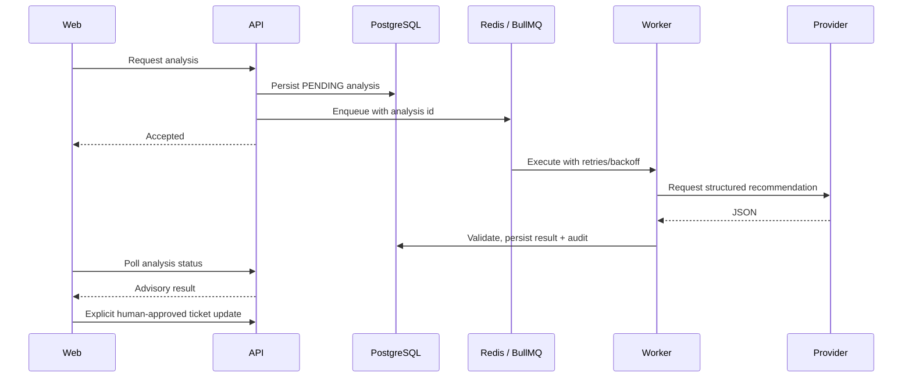

# Architecture

SupportPilot separates the web experience, request-time business rules, durable storage, and background processing.

- **Web:** Next.js/React with shared application shell, forms, ticket list/detail, conversation, SLA, and AI components. A shared API client handles JSON errors, session refresh, and timeouts. Frontend navigation guards do not authorize API operations.
- **API:** Express routes validate payloads, enforce current-account authentication and RBAC, then call domain services. Prisma transactions couple ticket changes with their audit/history records. A central error handler returns sanitized JSON and request IDs.
- **Database:** PostgreSQL stores users, teams, tickets, messages, assignments, refresh-token hashes, SLA events, audits, and AI analyses. Foreign keys define deletion behavior; indexes support queue lookups and event history. Notification tables are reserved, without a delivery implementation.
- **Workers:** BullMQ uses Redis for background AI execution and periodic SLA scans. Workers persist result state and handle retries independently of the HTTP request. The API does not wait for model inference.
- **Provider:** An interface isolates model-vendor calls. The current Groq adapter sends public conversation and validates the resulting structured data before persistence. Disabled AI does not disable ticket workflows.

See [product decisions](product-decisions.md) for transaction boundaries, SLA semantics, session-storage limitations, and queue recovery limits. See [deployment](deployment.md) for process/environment setup and [testing](testing.md) for the distinction between database-backed tests and UI rendering fixtures.
